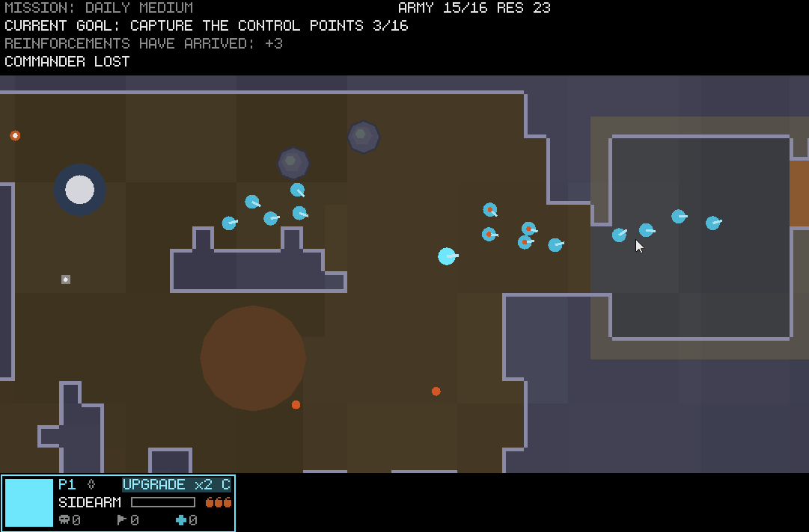
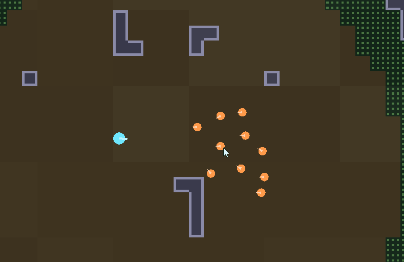
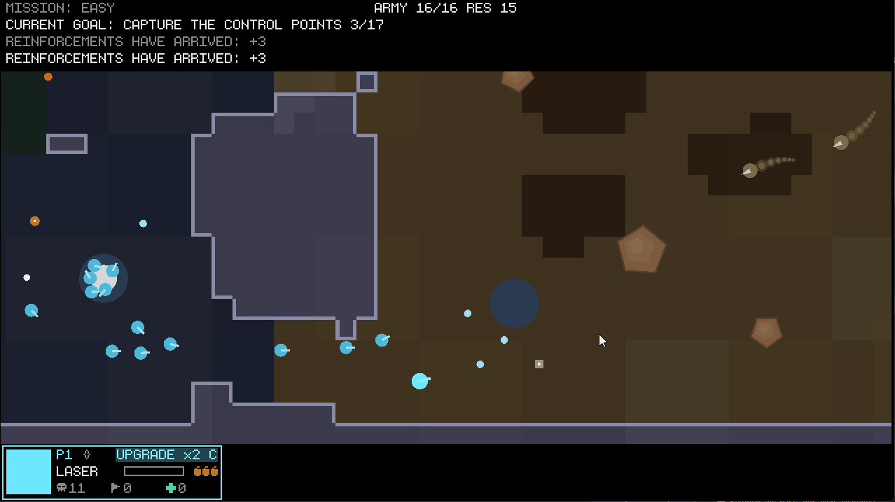

# Project-W - A Study on Building Software with AI Agents.

**Case study: a top-down squad shooter built with Java and libGDX.**

Inspired by *Triumph! War 2099* (Darksun Games, 2001)


## Built with AI agents

I started this project to learn, and have fun. In this project the agent is a targeted
tool inside a workflow I designed - it writes most of the code, I make the decisions.

*As of November 2026: about 2,900 tests, 22 architecture decision records, 97 gameplay decision records, 5 architecture-test suites, and 220 commits in 10 weeks of spare-time work.*

Some practices I used in this project:

**The full list - more practices and how the workflow evolved - is in the [AI playbook](docs/ai-playbook.md) 👈**

| Practice | Why it matters |
|---|---|
| **[Rules enforced by build, not the prompt](docs/adr/0005-quality-tooling.md)** | An instruction can be forgotten; a failing build cannot. [ArchUnit](sim/src/test/java/pl/mzebrows/pwt/sim/ArchitectureTest.java) guards every module boundary, NullAway and Error Prone run with warnings as errors, and tests police config files and even the docs. |
| **[Layered context](CLAUDE.md)** | A short always-on instruction file holds only what applies to every change. Everything else sits behind a "read it when" table, so the agent loads fourteen documents' worth of rules only when the task calls for them. |
| **[Decisions recorded with their rejected alternatives](docs/adr/README.md)** | Every structural and [gameplay](docs/design/decisions/README.md) decision is a one-page record with a "Do not build" line. An agent with no memory stops re-proposing what was already turned down. |
| **[Determinism as the test harness](docs/determinism.md)** | The simulation is a pure function of seed and input, so any bug replays. Replay and fuzz tests run every scenario twice, and a [whole online session](net/src/test/java/pl/mzebrows/pwt/net/session/SessionHarness.java) - host, peers, lag, a desync healed - runs inside one unit test. |
| **[A disciplined loop](docs/workflow.md)** | Agree, plan, then write, tests first. A verification ladder starts at the cheapest check that can refute a change, and a failure protocol demands the cause in one sentence before any fix - two failed fixes and the agent stops and reports. |
| **[Agent skills](.claude/skills/)** | Repeatable procedures replace long prompts: adding a system, an enemy kind, a biome. Project skills supply the local rules underneath [Matt Pocock's](https://github.com/mattpocock/skills) engineering skills, which drive the session. |
| **[Guarded autonomy](docs/workflow.md#afk-runs)** | The same commands work on the desktop, in a sandbox and in the cloud. Unattended runs fan tickets out to agents in separate worktrees, behind [git hooks](.claude/hooks/git-guard.py) that keep them off `main` and away from the remote. |

---

## The game

> [!NOTE]
> **This is Alpha version.** The game logic come first, current art stays as placeholder.\
> **Couch co-op.** Up to four players on one machine.\
> **Online.** Up to eight players over LAN, a virtual LAN such as ZeroTier/Hamachi, or the internet through a relay you run yourself. No matchmaking service.\
> **Full gamepad support.** See [Controls](#controls).

You are a commander, and you are standing on the field. You have a gun, a handful of grenades and a squad
of troopers who follow you into whatever you walk into. In front of you is a swarm that does not hold
still: it breeds from nests, comes in waves and adapts as you grow stronger. Fights are won on reflexes,
levels on tactics, and you can die like anyone else.



### How it plays

- **You fight alongside your squad.** Troopers shoot, capture ground, rescue each other and finish what you start.
  Four orders steer them: follow me, forward, defend, cancel.
- **Upgrades are earned, never bought.** Roguelite-style: take control points, get upgrade cards, pick one.
- **The enemy swarm adapts too.** The stronger you get, the more it answers in kind.
- **A man down is not a man dead.** A trooper shot off his feet bleeds out where he fell. Reach him in
  time and you can stabilise him or haul him out; the same goes for you.
- **The squad is the resource.** Reinforcements come from a reserve that runs dry. Lose men carelessly
  and the finale arrives with nobody left to fight it.

Each alien is a different problem to solve, not just a bigger health bar. The **ant** has an armoured
head that turns bullets, so you get round it - or it grips one of your men and carries him off.
The **slinger** throws the riders on its back over your squad to land behind you. Two giants announce
themselves with a roar: the **searer** sprays burning shots across a cone, the **thumper** slams the
ground you are standing on. The newer biomes add more: the **frog** leaves venom slicks underfoot, the
**sludger** spits glue that slows your men, the **snake** winds through the sand wounding whoever it
passes, and the **worm** stays buried until it surfaces right under one of your men. And at the end of some missions a **boss** sits rooted in its lair among its
nests, too big to walk and with no need to.



### What's in it

- **Daily missions.** Three a day, one per difficulty tier, generated from a seed: a march through
  several biomes to a finale. Every mission has an eight-character code you can send to a friend.
- **A proving ground.** Pick an enemy, a gun and some upgrades, and see how it plays.
- **Co-op on one screen or several.** Four on a couch, eight over LAN or through a relay on the internet,
  joining through a game list or a room code.
- **The same game on every machine.** The simulation is deterministic, so online play sends only
  inputs - and any bug can be replayed.



---

## Controls

Player one plays on keyboard and mouse, everyone else on a gamepad. The full list is in the game under
**CONTROLS** in the main menu, and every binding can be changed in
[`assets/controls.properties`](assets/controls.properties).

| | Action | Keyboard & mouse | Gamepad (Xbox / PlayStation) |
|---|---|---|---|
| 🏃 | Move | `WASD` or arrows | Left stick |
| 💨 | **Dash** - a short burst the way you are moving, not where you aim. Two charges (the purple pips on your panel), back one at a time; no invulnerability, and walls still stop you | **`Space`** or left **`Shift`** | **`B` / `R4`** |
| 🆙 | **Upgrades** - open the cards you have earned, then pick one | **`C`**, then `1`-`3` | **`Y` / `Triangle`**, then d-pad |
| 🎯 | Aim and fire | Mouse, left button | Right stick, `RT` / `R2` |
| 🗡️ | Hand strike | Mouse, right button | Right stick, `LT` / `L2` |
| 💣 | Throw a grenade | `Q` | `RB` / `R1` |
| ✋ | Act: open a crate or door, stabilise a man, man a turret | `E` | `A` / `Cross` |
| 📣 | Squad orders: follow me, forward, defend, cancel | `1`-`4` | D-pad |
| 🔭 | **Zoom out** - pull the view back over the whole fight, press again to return | **`Tab`** | **`LB` / `L1`** |

---

## Build & run

Requires JDK 25. Gradle comes from the wrapper.

```
./gradlew lwjgl3:run              # start the game
./gradlew test                    # run every test
./gradlew :sim:test               # run one module's tests: map, sim, net, ui or core
./gradlew spotlessApply build     # format, compile, lint and test everything - the full check
./gradlew lwjgl3:packageWinX64    # Windows build with Java bundled, in dist/
```

### The relay

The relay is the headless server that internet games meet through (ADR 0023). Players type its address on the
PLAY ONLINE page (SERVER IP, SERVER PORT) - no config file to edit.

```
./gradlew :relay:run                           # run it from source on the port in network.properties
./gradlew :relay:run --args="24800"            # ... on another port
./gradlew :relay:test                          # run the relay's tests
./gradlew :relay:relayJar                      # build relay/build/libs/pwt-relay.jar, everything included
```

Deploy: copy the jar to the server (Java 25), open the port for **TCP and UDP** (24741 by default), and run

```
java -jar pwt-relay.jar                        # port 24741, settings as shipped
java -jar pwt-relay.jar 24800                  # another port
java -jar pwt-relay.jar relay.properties 24800 # override lines for network.properties keys, and a port - both optional
```

It prints a banner with its build id and limits, echoes rooms and links to the console and writes the full log to
`logs/net/`. Redeploy it with every game build that changes `map`, `sim` or the session protocol - the build ids must
match. Details: [`docs/packaging.md`](docs/packaging.md#the-relay-as-a-jar).

Modules depend one way: `lwjgl3` -> `core` -> {`ui`, `net`} -> `sim` -> `map`. How agents work in this
repository starts at [`CLAUDE.md`](CLAUDE.md); everything else is in [`docs/`](docs/).

---

## License

[MIT](LICENSE). Fork it, change it, ship it - keep the copyright notice. If you build something on it,
a line in your credits is appreciated.
